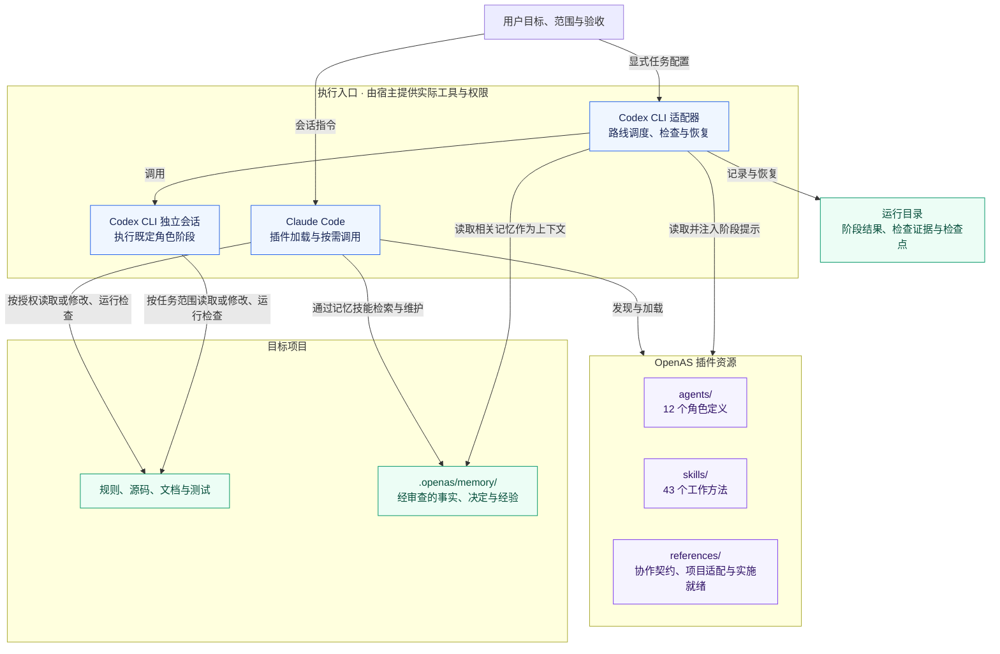
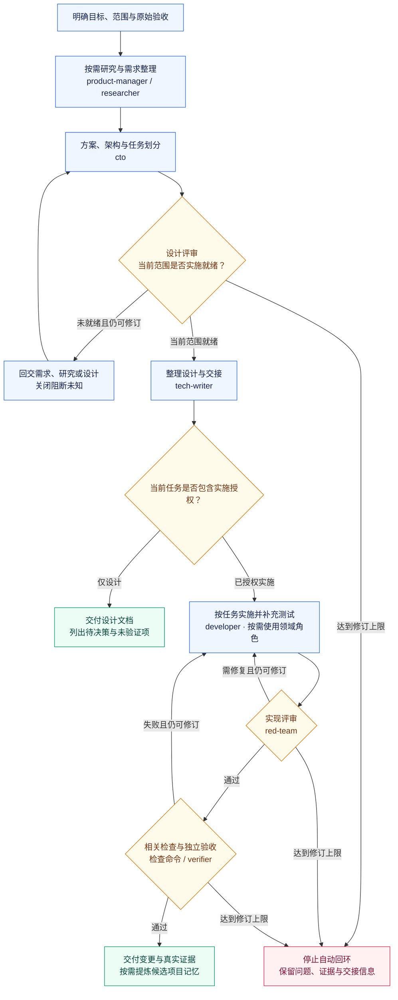

<div align="center">

# OpenAS

**Open Agents & Skills**

让 AI 开发从明确的需求出发，以可验证的结果交付。

[](https://github.com/xiangguangxin/OpenAS/actions/workflows/ci.yml)
[](plugins/openas/agents)
[](plugins/openas/skills)
[](LICENSE)

可插拔的角色协作 · 证据驱动的调试 · 可追溯的项目记忆

[快速开始](#快速开始) · [角色团队](#角色团队) · [技能地图](#技能地图) · [整体架构](#整体架构) · [工作流程](#工作流程) · [安装与更新](#安装与更新) · [MCP 集成](#可选-mcp-集成) · [开发与验证](#开发与验证)

</div>

---

OpenAS 将需求分析、方案设计、开发调试、评审与验证整理为可按需组合的工作方法。通过 **Claude Code 插件**使用 12 个协作角色与 43 个技能，也可使用独立的 **Codex CLI 工作流适配器**执行阶段任务与验收。

适用于 Web 应用、后端服务、库、命令行工具、原生程序、数据处理和文档项目。接入后沿用目标仓库的技术栈、目录与验证命令，无需额外创建 OpenAS 专用配置文件。

## 快速开始

在**目标项目目录**中启动 Claude Code，将路径替换为你的 OpenAS 所在位置：

```bash
claude --plugin-dir /path/to/OpenAS/plugins/openas
```

在会话中按任务调用技能：

```text
/openas:solution-design 根据当前需求形成方案，明确接口、失败行为和实施就绪条件
/openas:bug-fix 排查这个问题，用当前项目的日志和测试验证根因
/openas:test-strategy 根据需求和风险制定测试场景与覆盖计划
/openas:project-memory 提炼本次任务中有证据、可复用的项目经验
```

技能和角色统一使用 `openas:` 命名空间。`--plugin-dir` 只对本次启动生效；修改本地插件后，可在当前会话运行 `/reload-plugins`，更新后续调用使用的组件。

<details>
<summary>更多调用示例</summary>

```text
/openas:technical-research 调研当前项目的数据存储方案，保留来源和关键未知项
/openas:github-skill-discovery 按当前需求从 GitHub 查找制作 PPT 的技能，核对内容、依赖与许可证，先交付候选比较
/openas:technical-diagrams 为当前文档绘制架构图
/openas:project-documentation 根据源码完善 README 和入门指南，核对示例
/openas:github-skill-discovery 按需求搜索并融合多个技能，生成适合当前项目的新技能，保留来源版本、许可与验证记录

/openas:presentation-creation 根据当前材料制作 10 分钟项目汇报，交付可编辑 PPTX、源稿和预览，保留数据来源
/openas:competitive-analysis 对比同类工具在目标使用场景中的能力与限制
/openas:roadmap-planning 将需求和调研结论整理为 MVP 与阶段验收目标
/openas:interaction-design 将已确认需求整理为用户流程、界面状态和交互规格
/openas:performance-analysis 建立可复现基线，用剖析与对照实验定位瓶颈
```

</details>

## 为什么使用 OpenAS

| 能力 | 工作方式 |
| --- | --- |
| **按需协作** | 简单任务调用单个技能；复杂任务按需要组合角色，统一范围、交接与问题追踪 |
| **设计可实施** | 按风险确定设计深度，明确边界与失败行为，用可验证行为拆分任务 |
| **调试有证据** | 从需求、设计、实现、配置与环境调查原因，用日志和可区分实验建立因果链 |
| **交付可核验** | 保留命令、退出码、关键输出与覆盖限制，区分事实、假设和未运行项 |
| **记忆可追溯** | 项目经验经审查后复用，直接证据或显式关联来源变化时排除旧记录 |
| **适配已有工程** | 读取目标仓库的规则、源码与 CI，沿用已有工具链和领域约束 |

设计与任务拆分的具体标准见 [设计粒度与实施就绪](plugins/openas/references/implementation-readiness.md)，项目接入约定见 [项目适配说明](plugins/openas/references/project-context.md)。

## 角色团队

每个角色都有明确输入、交付物和职责边界，共用 [团队协作契约](plugins/openas/references/team-contract.md)。角色按任务需要选用。

| 阶段 | Agent | 职责 |
| --- | --- | --- |
| 需求 | [product-manager](plugins/openas/agents/product-manager.md) | 用户与市场证据、产品范围、优先级与验收 |
| 研究 | [researcher](plugins/openas/agents/researcher.md) | 技术取证、候选比较与 PoC |
| 架构 | [cto](plugins/openas/agents/cto.md) | 设计取舍、接口契约与可执行任务 |
| 交互 | [ux-designer](plugins/openas/agents/ux-designer.md) | 用户流程、信息架构与界面状态 |
| 实现 | [developer](plugins/openas/agents/developer.md) | 授权范围内的实现、修复与相关测试 |
| 测试 | [test-engineer](plugins/openas/agents/test-engineer.md) | 测试策略、自动化测试与跨模块回归 |
| 性能 | [performance-engineer](plugins/openas/agents/performance-engineer.md) | 基准、剖析与优化对照实验 |
| 运维 | [it](plugins/openas/agents/it.md) | 开发环境、CI、部署配置与恢复 |
| 安全 | [security-reviewer](plugins/openas/agents/security-reviewer.md) | 信任边界、安全问题与修复建议 |
| 评审 | [red-team](plugins/openas/agents/red-team.md) | 有证据的反例、失败条件与缺陷 |
| 文档 | [tech-writer](plugins/openas/agents/tech-writer.md) | 基于源码和证据的说明与图表 |
| 验收 | [verifier](plugins/openas/agents/verifier.md) | 对照原始验收独立核查实际产物 |

## 技能地图

43 个技能可独立使用，也可组合到角色任务中。下表列出常用入口，完整定义见 [skills](plugins/openas/skills)。

| 任务 | 技能入口 | 主要产物 |
| --- | --- | --- |
| 市场与需求 | [market-research](plugins/openas/skills/market-research/SKILL.md) · [competitive-analysis](plugins/openas/skills/competitive-analysis/SKILL.md) · [product-requirements](plugins/openas/skills/product-requirements/SKILL.md) | 用户与竞品证据、PRD、需求 ID 与验收 |
| 技术研究 | [technical-research](plugins/openas/skills/technical-research/SKILL.md) · [technology-selection](plugins/openas/skills/technology-selection/SKILL.md) | 来源索引、候选矩阵、PoC 与 ADR |
| 外部技能引入 | [github-skill-discovery](plugins/openas/skills/github-skill-discovery/SKILL.md) | 按需搜索、内容/依赖/许可证审查、安装或适配、多技能融合生成与来源版本记录 |
| 方案与架构 | [solution-design](plugins/openas/skills/solution-design/SKILL.md) · [architecture-design](plugins/openas/skills/architecture-design/SKILL.md) · [design-review](plugins/openas/skills/design-review/SKILL.md) | 方案取舍、模块契约与实施就绪结论 |
| 架构检查与演进 | [architecture-conformance](plugins/openas/skills/architecture-conformance/SKILL.md) · [architecture-evolution](plugins/openas/skills/architecture-evolution/SKILL.md) | 架构偏差证据、分阶段改造、兼容与退役条件 |
| 规划与实施 | [roadmap-planning](plugins/openas/skills/roadmap-planning/SKILL.md) · [writing-plans](plugins/openas/skills/writing-plans/SKILL.md) · [test-driven-development](plugins/openas/skills/test-driven-development/SKILL.md) | 阶段目标、可执行任务与行为测试 |
| 测试工程 | [test-strategy](plugins/openas/skills/test-strategy/SKILL.md) · [integration-testing](plugins/openas/skills/integration-testing/SKILL.md) | 测试矩阵、隔离夹具与回归证据 |
| 交互与可访问性 | [interaction-design](plugins/openas/skills/interaction-design/SKILL.md) · [accessibility-review](plugins/openas/skills/accessibility-review/SKILL.md) | 交互规格、状态与操作障碍评审 |
| 性能与安全 | [performance-analysis](plugins/openas/skills/performance-analysis/SKILL.md) · [security-review](plugins/openas/skills/security-review/SKILL.md) | 对照实验、瓶颈证据与安全缺陷 |
| 故障与恢复 | [bug-fix](plugins/openas/skills/bug-fix/SKILL.md) · [incident-response](plugins/openas/skills/incident-response/SKILL.md) | 根因证据、恢复时间线与核验结果 |
| 文档与代码评审 | [document-review](plugins/openas/skills/document-review/SKILL.md) · [requesting-code-review](plugins/openas/skills/requesting-code-review/SKILL.md) | 文档事实与操作可用性、代码缺陷、证据及评审结论 |
| 文档与图表 | [project-documentation](plugins/openas/skills/project-documentation/SKILL.md) · [technical-diagrams](plugins/openas/skills/technical-diagrams/SKILL.md) | 项目说明、接口文档与 Mermaid / SVG / D2 图表 |
| 演示文稿 | [presentation-creation](plugins/openas/skills/presentation-creation/SKILL.md) | 内容与叙事、原生可编辑 PPTX、讲稿备注、JSON 源稿与渲染预览 |
| 记忆与交付 | [project-memory](plugins/openas/skills/project-memory/SKILL.md) · [verification-before-completion](plugins/openas/skills/verification-before-completion/SKILL.md) | 可审查经验与真实验收记录 |

## 整体架构

OpenAS 提供两条独立入口，共用仓库中的角色、技能与协作约定。下图展示组件关系，连线标注加载、调用与数据读写的含义。



角色和技能是供宿主读取的资源；实际执行由 Claude Code 或 Codex CLI 会话完成。Codex 适配器按既定路线选择角色，新增角色不会自动加入所有工作流；记忆审查与复用规则见 [项目记忆说明](plugins/openas/memory/README.md)。

## 工作流程

下图展示完整开发任务的协作逻辑。已有有效需求和设计时可复用对应阶段；修复、只读评审、文档等路线按各自范围执行，具体阶段以 [运行指南](plugins/openas/workflows/README.md) 为准。



“实施就绪”针对明确范围判断：关键契约和失败行为已确定，验收有对应模块及验证方法。领域角色按需参与，图中研究与计划节点表示协作职责，不代表每条运行器路线都会单独派发这些角色。达到宿主配置的修订上限时保留现场，不跳过门禁。

- **完整设计**：支持 [市场与竞品调研到设计文档](plugins/openas/skills/solution-design/references/research-to-design.md)，保留来源、需求与验收关联。设计默认交付到文档；已授权实施时再拆任务。
- **编排与恢复**：七个编排技能覆盖路线选择、任务依赖、检查点恢复、失败处理、上下文交接、并行成果集成与验收追踪。运行器支持开发、修复、直接修改、评审、安全评审、运维、文档及调研设计路线。
- **阶段证据**：Codex CLI 适配器保留输出、文件指纹、`handoff.json` 与逐项 `acceptance.json`。中断后显式使用 `--resume` 核对任务、规则和源码，复用有效阶段，按需重跑失效证据。

依赖图目前顺序调度，并行集成技能不等于自动并行执行。Agent 调用、热加载、联网检索和工具执行以客户端能力及会话授权为准。`research-design` 路线支持显式联网与已有资料两种模式，联网模式缺少原生搜索证据时停止。

详见 [工作流指南](plugins/openas/workflows/README.md)、[调研设计验收](docs/research-design-acceptance.md) 与 [编排验收记录](docs/orchestration-acceptance.md)。

## 安装与更新

### 本地开发与热加载

开发插件时，建议使用 `--plugin-dir` 直接加载本地目录。修改 `plugins/openas` 下的文件后，在已启动的 Claude Code 会话中运行：

```text
/reload-plugins
```

热加载会重新读取插件组件，供后续调用使用，无需将文件复制到各个项目的 `.claude` 目录。如客户端提示缓存问题，按提示决定是否使用 `/reload-plugins --force`。正在执行的任务和外部进程不保证同步切换到新版本。

### 持久安装到项目

在目标项目目录的终端中添加本地 marketplace，并安装插件：

```bash
claude plugin marketplace add /path/to/OpenAS
claude plugin install openas@openas-marketplace --scope project
```

安装后，在会话中运行 `/reload-plugins` 应用。后续可按需启用、禁用或卸载：

```bash
claude plugin disable openas@openas-marketplace --scope project
claude plugin enable openas@openas-marketplace --scope project
claude plugin uninstall openas@openas-marketplace --scope project
```

操作后再次运行 `/reload-plugins`。同一插件请选择本地目录或 marketplace 中的一种加载方式，避免重复加载。

### 更新已安装版本

marketplace 安装可能使用缓存副本。维护者发布更新时需递增插件版本号；使用者随后在终端执行：

```bash
claude plugin marketplace update openas-marketplace
claude plugin update openas@openas-marketplace --scope project
```

最后在会话中运行 `/reload-plugins`。具体命令及可用参数以本地 Claude CLI 的帮助信息为准。

## 可选 MCP 集成

MCP（Model Context Protocol）让 AI 客户端连接外部工具和数据源。在 OpenAS 中，**agent 承担职责，skill 提供工作方法，MCP 提供可调用的工具**。例如，test-engineer 按测试技能设计场景，再通过 Playwright MCP 操作页面、观察结果并记录证据。

核心角色和技能可独立使用；需要浏览器、远程仓库或文档检索能力时，再选择相应集成。客户端已有等价工具时可直接复用，同一个技能也可以使用不同工具。

### 已提供的集成

| 集成 | 适用任务 | 常用角色 | 配置与使用 |
| --- | --- | --- | --- |
| **Playwright** | 自动操作页面、读取结构快照、检查用户流程与页面状态 | test-engineer、verifier、ux-designer | [基础概念、主要功能、配置与验收](plugins/openas/integrations/playwright/README.md) |
| **GitHub MCP Server** | 读取仓库、Issue、PR 和 CI 记录；配置示例默认只读 | product-manager、developer、red-team、it | [基础概念、主要功能、配置与验收](plugins/openas/integrations/github/README.md) |
| **Context7** | 检索库与框架文档，核对 API 的版本与适用条件 | researcher、cto、developer | [配置、操作与验收](plugins/openas/integrations/context7/README.md) |

每项集成都包含配置模板、角色与技能使用指引、最小验收步骤，以及工具不可用时的替代方式。浏览器操作记录可作为本次检查证据，需长期回归的行为仍应写入项目测试；文档检索结果也需与项目实际版本核对。

### 如何启用

首次交付客户时，按 [统一接入指南](plugins/openas/integrations/QUICKSTART.md) 使用配置工具合并所选服务、提供客户自己的凭据并执行本地预检，再在客户端完成真实连接与逐项验收。也可按下列步骤手工配置。

1. 打开所需集成的说明，准备运行环境及相应凭据。
2. 将其 `claude.mcp.example.json` 中需要的服务条目合并到**目标项目**的 `.mcp.json`，保留已有配置；凭据通过环境变量提供。
3. 重连 Claude Code 会话，在 `/mcp` 检查服务连接和实际可用工具，再按该集成的最小验收步骤执行一次任务。

这些模板面向 Claude Code。其他客户端需按各自格式注册；现有 Codex CLI 工作流适配器不会自动读取这些模板。角色若有工具白名单，还需在实际客户端中允许相应工具。

**当前支持范围：配置模板与使用指引已提供，真实连接和任务验收需在目标环境完成。** 加载 OpenAS 不会自动安装或注册 MCP 服务，也不会分发凭据。完整说明见 [MCP 集成指南](plugins/openas/integrations/README.md)。

## 项目记忆

技能、角色和脚本随插件分发，任务产生的记忆则保存在**目标项目**的 `.openas/memory/` 中。插件更新或卸载后，项目记忆仍然保留。各项目的记录独立管理，记忆功能不会改写项目的 `CLAUDE.md`。

使用记忆 CLI 时，必须显式指定目标项目根目录：

```bash
python3 /path/to/OpenAS/plugins/openas/skills/project-memory/scripts/project_memory.py \
  --root /path/to/your-project query '输入校验 根因'
```

可复用结论先进入候选状态，经审查后才能用于后续任务；直接证据或显式关联的原始来源发生变化时，旧记录会被检索排除。存储格式、检索与维护方式见 [项目记忆说明](plugins/openas/memory/README.md)。是否纳入版本管理应遵循项目约定，原始日志、core dump 和敏感信息不应直接共享。

项目学习支持四阶段闭环：**自动复盘采集 → 经验提炼与独立审查 → 候选技能生成、试用与启用 → 使用反馈、停用及版本回滚**。单任务运行器启用记忆时自动采集观察；加 `--learn` 后额外调用模型提炼、评审并生成草稿。技能经正反例试用与独立评审后才复用，不修改插件自带技能或权限。命令和验证范围见 [项目学习与技能演进](plugins/openas/memory/learning.md)。

## Codex CLI 工作流

除 Claude Code 插件外，OpenAS 还提供基于 Python 标准库的 [Codex CLI 工作流适配器](plugins/openas/workflows/README.md)。它使用已安装、已登录的 Codex CLI，顺序调用角色并执行验收命令，记录阶段结果、文件变化和验证证据。

这两个入口分别使用：Claude Code 通过插件发现角色与技能；Codex 适配器显式读取相关资源并调用 CLI，`plugin.json` 本身不会让 Codex 自动加载插件。适配器不自动安装 SDK，也不修改客户端全局配置。

## 开发与验证

以下命令在 OpenAS 仓库根目录运行。Python 工具要求 Python 3.10+，JavaScript 工作流测试使用 Node.js 22；项目记忆依赖 POSIX 文件锁，当前支持 Linux / WSL。

### 本地检查

```bash
python3 scripts/check_plugin.py
PYTHONDONTWRITEBYTECODE=1 python3 -m unittest discover -s tests -v
PYTHONDONTWRITEBYTECODE=1 python3 -m unittest discover -s plugins/openas/workflows/tests -p 'test_*.py' -v
node plugins/openas/workflows/tests/agent-team.test.mjs
```

这些检查覆盖插件结构、资源链接和工作流回归，不安装依赖、不调用模型。

演示文稿的原生对象测试需要先在隔离环境安装 [固定依赖](plugins/openas/skills/presentation-creation/requirements.txt)，未安装时对应测试会跳过；CI 已安装这些依赖。真实 Office 渲染和原生客户端验收另行执行。

已有 Claude CLI 时，可进一步验证插件清单：

```bash
claude plugin validate ./plugins/openas
claude plugin validate .
```

真实客户端的热加载验收由可选集成测试完成，默认跳过。运行条件、额度上限和断言见 [热加载测试说明](docs/hot-reload-testing.md)。结构检查和模拟客户端测试的结果应与真实客户端验收分别看待。

### 持续集成

GitHub Actions 在 PR 创建或更新，以及代码推送或合并到 `main` 后执行检查。配置见 [CI 工作流](.github/workflows/ci.yml)，运行方式与合并检查设置见 [CI 说明](docs/ci.md)。初始移植的验收范围保存在 [验收记录](docs/validation.md) 中，最新回归结果以 GitHub Actions 为准。

## 目录结构

```text
.claude-plugin/marketplace.json   本地 marketplace 入口
plugins/openas/
  .claude-plugin/plugin.json     插件清单与版本
  agents/                       12 个协作角色
  skills/                       43 个技能及配套资源
  references/                   协作契约与项目适配约定
  workflows/                    可选适配器、示例、测试与历史证据
  integrations/                 可选 MCP 配置、使用指引与 REA 集成
  memory/README.md              项目记忆存储约定
scripts/check_plugin.py         只读结构校验器
```

## 来源与参考

OpenAS 最初从 gem5 项目的协作配置中提取，现已将角色、技能与具体工程解耦。[迁移记录](docs/migration.json) 保留原始提交和文件指纹，供来源追溯；历史工作流报告与旧示例不作为新项目的默认上下文或验收证据。

REA 上游 Skill 及参考文件保留原文，并附 [MIT 许可](plugins/openas/integrations/rea/LICENSE)。相关 MCP 服务和分析工具为可选依赖，加载 OpenAS 不会自动安装或连接它们，详见 [REA 集成说明](plugins/openas/integrations/rea/README.md)。

演示文稿技能融合了已固定提交并核对许可的 MiniMax、K-Dense 与 OpenAI 历史 slides 方法，保留来源及适用条款，运行代码独立实现；详见 [融合与许可说明](plugins/openas/skills/presentation-creation/NOTICE.md)。该技能目录采用 Apache-2.0，附带来源 MIT 条款，不由仓库根 MIT 取代。

Claude Code 官方文档：[插件格式](https://code.claude.com/docs/en/plugins-reference)、[插件创建与迁移](https://code.claude.com/docs/en/plugins/create)、[热加载与管理命令](https://code.claude.com/docs/en/plugins/cli-reference)。

## 维护与验收

除明确标注的技能目录外，项目自有内容采用 [MIT License](LICENSE)；另行声明的目录与第三方内容遵循各自许可。版本变化见 [CHANGELOG](CHANGELOG.md)，开发与发布流程见 [贡献指南](CONTRIBUTING.md)，运行环境和记录格式见 [兼容说明](docs/compatibility.md)。

真实技能行为评测、修复验证及尚缺外部条件的项目分别记录在 [行为评测说明](docs/skill-evaluation.md) 和 [本次修复验收](docs/review-remediation.md) 中。
