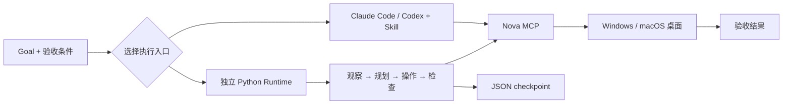
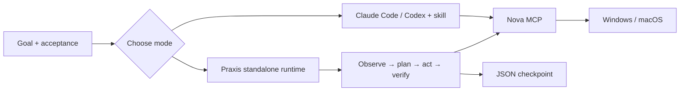

<a id="chinese"></a>

<div align="center">

# OpenAS

**Open Agents & Skills**

**从需求到交付，让 AI 开发有方法、有证据、可验收。**

[](https://github.com/xiangguangxin/OpenAS/actions/workflows/ci.yml)
[](plugins/openas/agents)
[](plugins/openas/skills)
[](LICENSE)

**简体中文** · [English](#english)

[快速开始](#快速开始) · [核心能力](#核心能力) · [运行方式](#运行方式) · [GUI Agent](#gui-agent) · [工作流程](#工作流程) · [技能与角色](#技能与角色) · [安装与集成](#安装与集成) · [验证与贡献](#验证与贡献)

</div>

---

OpenAS 是面向 Claude Code / Codex 的可组合 Agent 与 Skill 工具集，提供 **12 个角色、72 个技能**。独立桌面/浏览器 Runtime 已拆分为 [Praxis](https://github.com/xiangguangxin/Praxis)；OpenAS 继续提供 GUI Skill、工作流与 Nova MCP 接入。

> **核心原则：** 目标明确 → 按需选择技能 → 执行并收集证据 → 独立验收 → 交付可追溯结果。Skill 是工作方法，不等于自动获得工具权限或真实执行能力。

## 快速开始

**Claude Code：** 在目标项目目录中启动，并指向本地 OpenAS 插件。

```bash
claude --plugin-dir /path/to/OpenAS/plugins/openas
```

日常任务先走组合路由，再按返回的最小技能组合执行：

```text
/openas:workflow-routing 按目标、真实范围和风险选择最小技能组合与流程强度
/openas:solution-design 分析需求，明确方案、边界与验收条件
/openas:bug-fix 复现并定位问题，用测试验证修复
/openas:codebase-analysis 梳理项目入口、模块依赖和核心调用链
/openas:project-memory 提炼本次任务中可验证、可复用的经验
```

修改本地插件后，使用 `/reload-plugins` 重新加载后续调用所需的资源。也可以通过 [marketplace 安装](#安装与集成)。OpenAS 不会自动修改目标项目的技术栈或安装 MCP。

## 客户展示与工程接入

[客户演示指南](docs/customer-demo.md)提供 Codex 技能安装/原生发现、环境预检、工程隔离、缺陷修复、任务图中断恢复及 GUI 测试报告下载验收。每次工作流生成 HTML 交付报告，明确区分自动检查通过、待人工验收和失败。

## 核心能力

| 能力 | 解决什么问题 | 关键入口 |
| :--- | :--- | :--- |
| **角色协作** | 需求、架构、开发、测试、安全与验收职责分离 | [12 个角色](plugins/openas/agents) |
| **任务技能** | 将分析、开发、调试、评审等流程标准化 | [72 个技能](plugins/openas/skills) |
| **目标驱动 GUI** | 根据目标多轮观察桌面、执行操作与检查结果 | [gui-goal-executor](plugins/openas/skills/gui-goal-executor/SKILL.md) |
| **工作流编排** | 任务分阶段、依赖检查、失败恢复与交接 | [工作流指南](plugins/openas/workflows/README.md) |
| **软件重建** | 从授权观测提炼规格，独立构建并用可信观察器对比 | [原生重建流程](docs/reconstruction.md) |
| **项目记忆** | 审查、保存和复用有证据的项目知识 | [项目记忆](plugins/openas/memory/README.md) |
| **结果验收** | 将模型结论与真实命令、测试和产物证据区分 | [证据规则](plugins/openas/references/evidence-policy.md) |

## 运行方式

不同入口提供的能力与权限不同，请按任务选择：

| 入口 | 适用场景 | 依赖与限制 |
| :--- | :--- | :--- |
| **Claude Code 插件** | 在已有工程中按需调用角色与 Skill | Claude Code 客户端和实际授权的工具 |
| **Codex CLI 适配器** | 按明确路线执行阶段任务、记录证据和恢复 | 已安装、已登录的 Codex CLI；不会自动发现 Claude 插件 |
| **GUI Goal Skill** | 在 Claude Code / Codex 会话中完成桌面目标 | [computer-use](plugins/openas/skills/computer-use/SKILL.md) + 已连接的 Nova MCP |
| **Praxis 独立 Runtime** | 单独运行桌面 Agent Loop、保存 checkpoint、重启后恢复 | [Python 包](https://github.com/xiangguangxin/Praxis) + Nova MCP + 额外配置的多模态模型 API |

**特别注意：** 独立 Runtime 不继承 Claude Code / Codex 的模型订阅、MCP 注册或会话权限，也不是常驻后台服务。

## GUI Agent

<details open>
<summary><strong>桌面任务如何从 Goal 走到验收？</strong></summary>



</details>

| 组件 | 职责 | 文档 |
| :--- | :--- | :--- |
| [gui-goal-executor](plugins/openas/skills/gui-goal-executor/SKILL.md) | Goal、动态规划、停止条件与验收规范 | [Skill](plugins/openas/skills/gui-goal-executor/SKILL.md) |
| [computer-use](plugins/openas/skills/computer-use/SKILL.md) | 优先 UIA / AX 定位，必要时截图辅助 | [Skill](plugins/openas/skills/computer-use/SKILL.md) |
| [Nova MCP](plugins/openas/integrations/computer-use/USER-GUIDE.md) | 截图、窗口、鼠标键盘等桌面工具 | [安装与授权](plugins/openas/integrations/computer-use/USER-GUIDE.md) |
| [Praxis Runtime](https://github.com/xiangguangxin/Praxis) | 独立 Agent Loop、模型决策、checkpoint 与恢复 | [CLI 与配置](https://github.com/xiangguangxin/Praxis) |

例如：打开覆盖率 GUI、运行测试、生成报告，并在报告存在且符合验收条件后才宣布完成。

独立 Runtime 支持可选的[文件验收](https://github.com/xiangguangxin/Praxis/blob/main/RUNTIME.md#artifact-verification)、[离线 Benchmark](https://github.com/xiangguangxin/Praxis/blob/main/RUNTIME.md#agent-benchmark) 和[经验检索与衰减](https://github.com/xiangguangxin/Praxis/blob/main/RUNTIME.md#opt-in-experience-assisted-planning-and-lifecycle)。历史经验仅作为规划提示，不自动重放操作；checkpoint 恢复也不代表后台自动继续。

**验证边界：** CI 与模拟测试不等于真实 Windows/macOS + Nova 端到端验收。桌面操作需要用户安装并授权 Nova；高风险操作应经过确认。建议先在隔离环境测试。

## 常见任务：先选组合，再选强度

| 任务 | 默认最小技能组合 |
| --- | --- |
| 新功能 | solution-design → test-driven-development → verification-before-completion |
| 修 Bug | bug-fix → verification-before-completion |
| 重构/影响评估 | change-impact-analysis → code-simplification → verification-before-completion |
| 文档/汇报 | project-documentation → verification-before-completion |

**light** 只保留范围、复现/检查命令、退出码及对象指纹；**standard** 增加适用设计、独立评审/验收；**heavy** 对接口、安全、数据、并发和核心性能风险增加影响分析与严格门禁。未知风险默认 standard，不能强行降为 light。Office、浏览器、桌面等低频能力仅在对应载体启用。

机器路由与轻量示例：

```bash
python3 plugins/openas/workflows/task_router.py --task plugins/openas/workflows/examples/tiered-light-task.json
python3 scripts/check_plugin.py --memory /path/to/records.json --evidence /path/to/run/rigor-evidence.json
```

见 [组合与分级入口](plugins/openas/skills/workflow-routing/SKILL.md)及[运行器接入](plugins/openas/workflows/README.md#tiered-rigor)。分级由任务 JSON 显式启用；旧任务保持原流程。只读路由不执行任务，任务声明不授予生产权限。

## 软件重建

吸收 Craft Anything 的 Study → Build → Check → Refine 方法，原生实现于 OpenAS：clean-room/deep 观测边界、分页证据、未知项、可信行为/多视口截图对比，以及无进展停止。无需安装上游项目。入口：`python plugins/openas/workflows/reconstruct.py --help`。见[使用与来源说明](docs/reconstruction.md)。

## 工作流程


简单任务可只调用一个 Skill；复杂任务再按风险引入设计评审、代码评审、测试和验收。阶段失败保留证据，不以模型自述的“完成”代替真实验证。

- **开发与修复：** [solution-design](plugins/openas/skills/solution-design/SKILL.md)、[bug-fix](plugins/openas/skills/bug-fix/SKILL.md)、[verification-before-completion](plugins/openas/skills/verification-before-completion/SKILL.md)。
- **编排与恢复：** [工作流指南](plugins/openas/workflows/README.md)说明阶段依赖、checkpoint、handoff 与验收记录。
- **记忆与学习：** 项目知识保存在目标工程的 `.openas/memory/`，经审查后复用；与 GUI Runtime 的本地经验库相互独立。见[项目学习](plugins/openas/memory/learning.md)。

## 技能与角色

**12 个角色：** product-manager、researcher、cto、ux-designer、developer、test-engineer、performance-engineer、it、security-reviewer、red-team、tech-writer、verifier。职责见[角色定义](plugins/openas/agents)和[团队契约](plugins/openas/references/team-contract.md)。

**72 个技能：** 按任务领域选择，而不是一次性加载全部。

| 任务方向 | 推荐入口 |
| :--- | :--- |
| 需求与架构 | [product-requirements](plugins/openas/skills/product-requirements/SKILL.md) · [architecture-design](plugins/openas/skills/architecture-design/SKILL.md) |
| 理解与改造代码 | [codebase-analysis](plugins/openas/skills/codebase-analysis/SKILL.md) · [change-impact-analysis](plugins/openas/skills/change-impact-analysis/SKILL.md) |
| 开发与调试 | [test-driven-development](plugins/openas/skills/test-driven-development/SKILL.md) · [bug-fix](plugins/openas/skills/bug-fix/SKILL.md) |
| 测试与评测 | [test-strategy](plugins/openas/skills/test-strategy/SKILL.md) · [agent-evaluation](plugins/openas/skills/agent-evaluation/SKILL.md) |
| 桌面与浏览器 | [gui-goal-executor](plugins/openas/skills/gui-goal-executor/SKILL.md) · [browser-goal-executor](plugins/openas/skills/browser-goal-executor/SKILL.md) |
| 文档与知识 | [project-documentation](plugins/openas/skills/project-documentation/SKILL.md) · [project-memory](plugins/openas/skills/project-memory/SKILL.md) |

[浏览全部技能](plugins/openas/skills) · [英文技能索引](docs/skills.en.md)

## 安装与集成

**持久安装 Claude Code 插件：**

```bash
claude plugin marketplace add /path/to/OpenAS
claude plugin install openas@openas-marketplace --scope project
```

更新与卸载参见[插件安装说明](plugins/openas/integrations/QUICKSTART.md)和[贡献指南](CONTRIBUTING.md)。具体参数以本地 Claude CLI 帮助为准。

**可选 MCP：** 需要真实浏览器、GitHub、文档检索或原生桌面能力时再安装。插件本身不自动安装服务、授予权限或分发凭据。

| 集成 | 主要用途 | 指南 |
| :--- | :--- | :--- |
| Playwright | 浏览器自动化与页面验收 | [配置](plugins/openas/integrations/playwright/README.md) |
| GitHub | 仓库、Issue、PR、CI | [配置](plugins/openas/integrations/github/README.md) |
| Context7 | 依赖库与框架文档 | [配置](plugins/openas/integrations/context7/README.md) |
| Nova | Windows/macOS 桌面控制 | [配置](plugins/openas/integrations/computer-use/USER-GUIDE.md) |

[统一 MCP 接入指南](plugins/openas/integrations/QUICKSTART.md) · [Codex CLI 工作流](plugins/openas/workflows/README.md) · [独立 GUI Runtime](https://github.com/xiangguangxin/Praxis)

## 验证与贡献

项目检查以 Python 3.10+、Node.js 22 为基础；工作流锁与超时处理兼容 Windows/POSIX，Windows smoke 与桌面 E2E 分开验收。仓库根目录运行：

```bash
python3 scripts/check_plugin.py
PYTHONDONTWRITEBYTECODE=1 python3 -m unittest discover -s tests -v
PYTHONDONTWRITEBYTECODE=1 python3 -m unittest discover -s plugins/openas/workflows/tests -p 'test_*.py' -v
node plugins/openas/workflows/tests/agent-team.test.mjs
```

结构检查、模拟客户端、真实 Claude/Codex 和桌面 E2E 属于不同证据等级。参见 [CI](docs/ci.md)、[验收记录](docs/validation.md)、[贡献指南](CONTRIBUTING.md)及 [CHANGELOG](CHANGELOG.md)。

**许可证与来源：** 项目自有内容主要采用 [MIT](LICENSE)；REA、演示文稿及其他第三方材料遵循各自声明，见 [REA 来源](plugins/openas/integrations/rea/README.md)、[演示文稿 NOTICE](plugins/openas/skills/presentation-creation/NOTICE.md)、[DSH 来源](plugins/openas/references/dsh-skills-provenance.md)。

---

<a id="english"></a>

<div align="center">

# OpenAS · English

**Open Agents & Skills**

**From requirements to verifiable AI-assisted delivery.**

[](https://github.com/xiangguangxin/OpenAS/actions/workflows/ci.yml)
[](plugins/openas/agents)
[](docs/skills.en.md)
[](LICENSE)

[简体中文](#chinese) · **English**

[Quick start](#quick-start) · [Capabilities](#capabilities) · [Execution modes](#execution-modes) · [GUI agent](#gui-agent-runtime) · [Skills](#roles-and-skills) · [Setup](#setup-and-integrations) · [Validation](#validation-and-contributing)

</div>

OpenAS is a composable collection of **12 roles and 72 skills** for Claude Code and Codex workflows. Its standalone desktop/browser runtime is now maintained separately as [Praxis](https://github.com/xiangguangxin/Praxis); OpenAS retains GUI skills and Nova MCP integration guidance.

> **Guiding principle:** Define the goal → select only relevant methods → execute and collect evidence → verify independently → deliver traceable results.

## Quick start

Launch Claude Code from your target project:

```bash
claude --plugin-dir /path/to/OpenAS/plugins/openas
```

Start with a minimal task bundle, then invoke only the selected methods:

```text
/openas:workflow-routing Choose the minimal skill bundle and rigor from actual scope and risk.
/openas:solution-design Define the architecture, boundaries, and acceptance criteria.
/openas:bug-fix Reproduce the failure and verify the fix.
/openas:codebase-analysis Explain the entry points and core call path.
```

Use `/reload-plugins` after local plugin edits for subsequent invocations. For persistent installation, see [Setup](#setup-and-integrations).

## Customer demos

The [customer readiness guide](docs/customer-demo.md) covers Codex installation/native discovery, preflight, isolated workspaces, repair, graph recovery and real GUI report-download acceptance. Workflow HTML receipts distinguish automated checks, manual review and failure.

## Capabilities

| Capability | Purpose | Reference |
| :--- | :--- | :--- |
| Role-based collaboration | Separate product, design, engineering, review, and verification responsibilities | [Roles](plugins/openas/agents) |
| Task-focused skills | Reusable methods for development and delivery | [Skills](docs/skills.en.md) |
| Desktop GUI goals | Observe, plan, act, and verify through desktop tools | [GUI goal skill](plugins/openas/skills/gui-goal-executor/SKILL.en.md) |
| Workflow orchestration | Stage execution, handoffs, checkpoints, and acceptance | [Workflow guide](plugins/openas/workflows/README.en.md) |
| Project memory | Review and reuse evidence-backed project knowledge | [Memory guide](plugins/openas/memory/README.en.md) |
| Verification | Distinguish model claims from real test and artifact evidence | [Evidence policy](plugins/openas/references/evidence-policy.en.md) |

## Execution modes

| Mode | Best for | Requirements |
| :--- | :--- | :--- |
| Claude Code plugin | Using skills and roles within an existing project | Claude Code and authorized host tools |
| Codex CLI adapter | Explicit stage workflows with evidence and resume | Installed and authenticated Codex CLI |
| GUI goal skill | Desktop tasks in Claude Code / Codex | Connected Nova MCP and computer-use skill |
| Praxis standalone runtime | Separate agent loop, checkpoints, and restart resume | Nova MCP and separately configured multimodal model API |

The standalone runtime does **not** inherit Claude Code / Codex subscriptions, MCP registration, or session permissions. It is not a background daemon.

## GUI Agent Runtime



- [gui-goal-executor](plugins/openas/skills/gui-goal-executor/SKILL.en.md) specifies goal decomposition, replanning, stopping rules, and acceptance.
- [computer-use](plugins/openas/skills/computer-use/SKILL.en.md) prefers accessibility controls with screenshot fallback.
- [Nova MCP setup](plugins/openas/integrations/computer-use/USER-GUIDE.en.md) requires separate installation and user authorization.
- [Praxis Runtime](https://github.com/xiangguangxin/Praxis) adds its own model loop, JSON checkpoints, optional independent file verification, offline benchmark, and opt-in experience retrieval with aging and invalidation.

**Limitations:** A checkpoint enables restart-based resume, not automatic background continuation. Offline CI does not establish real Windows/macOS + Nova E2E success. Experience hints never authorize automatic replay or bypass safety checks.

## Frequent bundles and tiered rigor

Use the four minimal bundles above through [workflow-routing](plugins/openas/skills/workflow-routing/SKILL.en.md), rather than loading a flat catalog. Light tasks keep host evidence only; standard/heavy tasks add independent review/acceptance and risk-specific gates. Unknown risk defaults to standard, and unsafe downgrades are rejected. Office/browser/desktop methods activate only for matching carriers. Existing task JSON retains legacy behavior unless rigor is explicitly supplied.

## Software reconstruction

The native [reconstruction workflow](docs/reconstruction.md) adapts Craft Anything's study/build/check/refine method: observation modes, bounded evidence, unknowns, trusted behavior/viewport comparisons and idle-builder stopping. No upstream runtime or submodule is required.

## Roles and skills

The 12 roles cover product management, research, architecture, UX, development, testing, performance, operations, security, red-team review, technical writing, and independent verification. See [role definitions](plugins/openas/agents) and [team contract](plugins/openas/references/team-contract.en.md).

Use skills on demand rather than loading all 72 at once: [English skill catalog](docs/skills.en.md). Typical starting points are [solution-design](plugins/openas/skills/solution-design/SKILL.en.md), [codebase-analysis](plugins/openas/skills/codebase-analysis/SKILL.en.md), [bug-fix](plugins/openas/skills/bug-fix/SKILL.en.md), [agent-evaluation](plugins/openas/skills/agent-evaluation/SKILL.en.md), and [project-memory](plugins/openas/skills/project-memory/SKILL.en.md).

The general project memory lives in the target project's `.openas/memory/`; the optional GUI runtime experience store is separate. See [learning lifecycle](plugins/openas/memory/learning.en.md).

## Setup and integrations

```bash
claude plugin marketplace add /path/to/OpenAS
claude plugin install openas@openas-marketplace --scope project
```

Optional integrations are installed and authorized separately: [Playwright](plugins/openas/integrations/playwright/README.en.md), [GitHub](plugins/openas/integrations/github/README.en.md), [Context7](plugins/openas/integrations/context7/README.en.md), and [Nova](plugins/openas/integrations/computer-use/USER-GUIDE.en.md). See the [MCP quickstart](plugins/openas/integrations/QUICKSTART.en.md), [Codex workflow guide](plugins/openas/workflows/README.en.md), and [Python runtime guide](https://github.com/xiangguangxin/Praxis).

## Validation and contributing

Run from the repository root (Python 3.10+, Node.js 22; workflow locks/cancellation support Windows/POSIX, with separate Windows smoke and desktop E2E):

```bash
python3 scripts/check_plugin.py
PYTHONDONTWRITEBYTECODE=1 python3 -m unittest discover -s tests -v
PYTHONDONTWRITEBYTECODE=1 python3 -m unittest discover -s plugins/openas/workflows/tests -p 'test_*.py' -v
node plugins/openas/workflows/tests/agent-team.test.mjs
```

Structure checks, mocked tests, native client tests, and real desktop E2E have distinct evidence requirements. See [CI](docs/ci.en.md), [contributing](CONTRIBUTING.md), [changelog](CHANGELOG.md), and [license](LICENSE). Third-party materials retain their own notices, including [presentation](plugins/openas/skills/presentation-creation/NOTICE.md) and [REA](plugins/openas/integrations/rea/README.en.md).

## 决策、规格与专项扩展 / Decisions, specifications, and specialists

新增 [决策地图](plugins/openas/skills/decision-mapping/SKILL.md)与[规格驱动开发](plugins/openas/skills/spec-driven-development/SKILL.md)，补强任务切片、研究记录、动效和深度安全审计。React、Remotion、Neon、Azure 消息专项按需选择，普通任务保留原最小组合。

Use [decision mapping](plugins/openas/skills/decision-mapping/SKILL.en.md) and [specifications](plugins/openas/skills/spec-driven-development/SKILL.en.md) when needed; select React, Remotion, Neon, and Azure specialists explicitly. Existing minimal bundles remain unchanged. [Usage, source mapping, and limitations / 使用与来源](docs/skill-methods.md).
